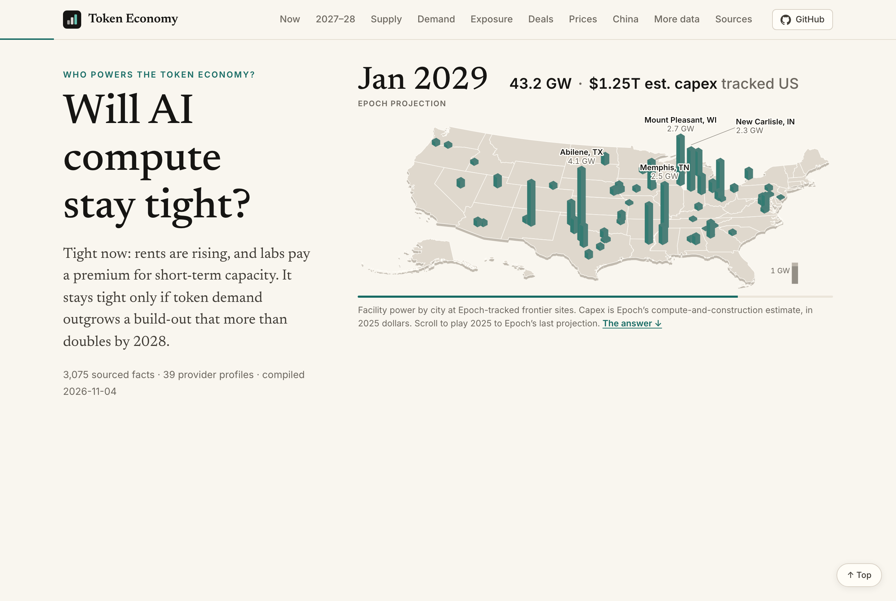
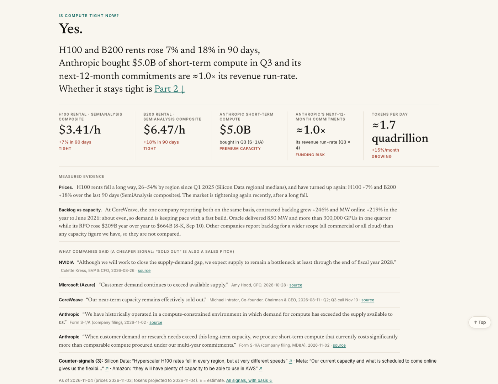
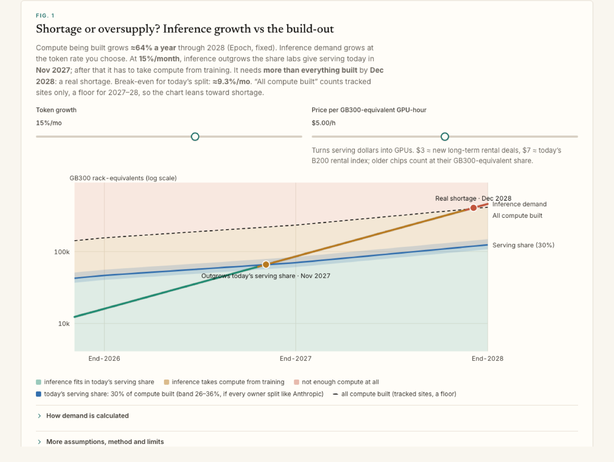
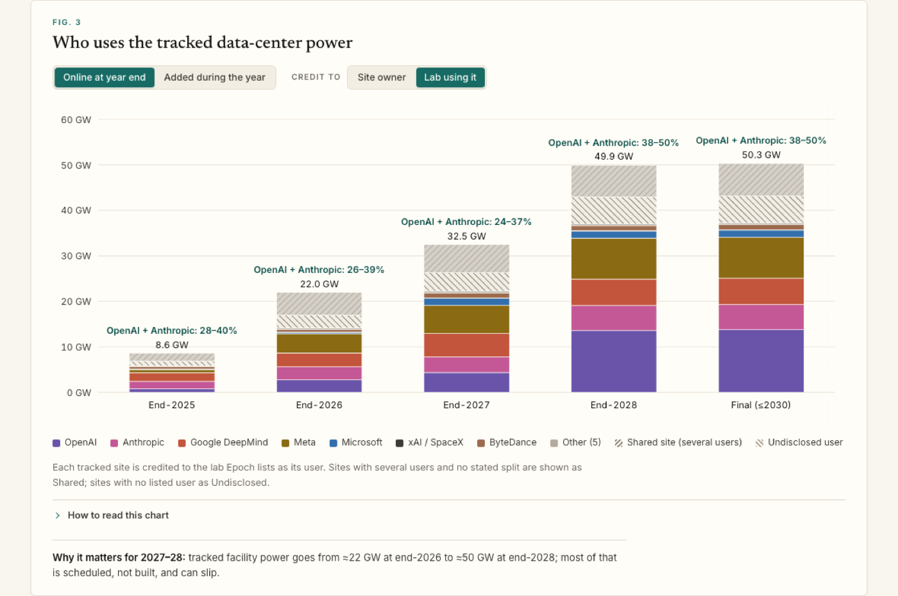
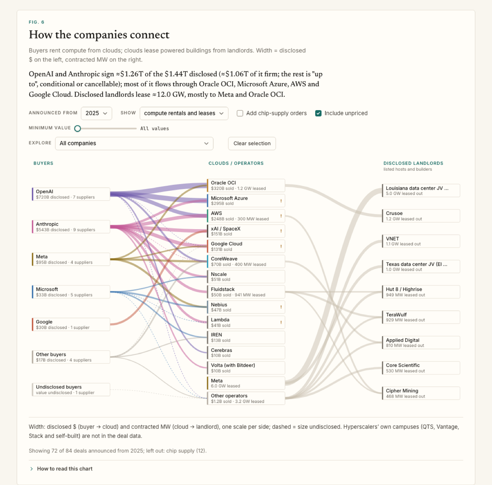
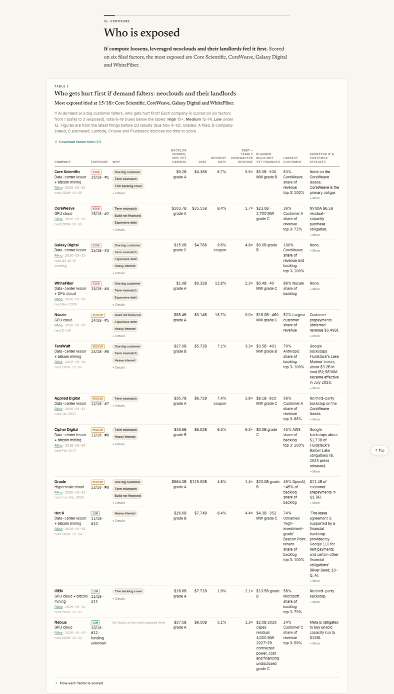

# Is AI compute tight now, and will it stay tight?

**Who powers the Token Economy?** A source-linked field guide to AI compute: chips, data centers, contracts, prices and inference traffic, built to answer two questions. Every figure on the page links to its source.

**Live page:** https://hxu296.github.io/ai-compute-landscape/

**New maintainer or agent?** Start with [ONBOARDING.md](ONBOARDING.md) for setup, source curation, verification, publication and a ready-to-copy starter prompt. [AGENTS.md](AGENTS.md) is the short entry point. **Agent messages:** use the [GitHub scratchpad](https://github.com/hxu296/ai-compute-landscape/tree/main/scratchpad).



## Main results (as of November 4, 2026)

The page refreshes prices and the token projection daily, so the live numbers move; these are the values on the date above. E = estimate.

**1. Now: compute is tight.**
- Rents are tightening again after a long fall: H100 rents fell 26–54% by region since Q1 2025 (Silicon Data regional medians), then rose over the last 90 days to H100 $3.41/h (+7%) and B200 $6.47/h (+18%) (SemiAnalysis composites).
- Anthropic bought $5.0B of short-term compute in Q3 2026 at a premium to its multi-year contracts, and its commitments due in the next 12 months are ≈1.0× its revenue run-rate (S-1/A, Nov 2).
- On the record: NVIDIA expects supply "to remain a bottleneck at least through the end of fiscal year 2028"; Microsoft says demand "continues to exceed available supply"; CoreWeave's near-term capacity is "effectively sold out". At CoreWeave, the one company reporting backlog and capacity on the same basis, backlog (+246%) and MW online (+219%) grew about evenly in the year to June 2026.



**2. 2027–28: it depends on one number.**
- Compute being built grows ≈64% a year through 2028 (Epoch AI tracked sites, ex-China; a floor).
- Token demand is ≈1.7 quadrillion logical tokens/day worldwide (E), growing ≈15% a month on each company's own trend.
- Priced at Anthropic's filed serving cost (≈$0.143 per million tokens) and $5 per GB300-equivalent GPU-hour, inference outgrows today's serving share of compute in **November 2027** on today's ≈15%/month trend, and, if that trend held for two more years (≈33× today's tokens), would need more than everything tracked as built by December 2028, a small margin next to how much tracked supply undercounts. The break-even is **≈9%/month (≈2.9× a year)**: faster means it stays tight, slower means it loosens. Tracked supply is a floor, so this leans toward shortage.



**3. Who holds the compute, and who is exposed if it loosens.**
- Tracked frontier sites hold ≈22 GW at end-2026 and ≈50 GW by end-2028. OpenAI and Anthropic use 26–39% of the end-2026 total and 38–50% of the end-2028 total (exclusive sites → including sites they share). Of the capacity added, they take 20–32% in 2027 but 65–75% in 2028 (48–59% across both years), so "most of the world's compute" holds only for 2028's additions.
- OpenAI and Anthropic sign ≈$1.26T of the ≈$1.44T in disclosed compute deals since 2025 (≈$1.06T of it firm; the rest is "up to", conditional or cancellable), mostly through Oracle, Microsoft, AWS and Google.
- Most exposed if demand falters (tied at 15/18): Core Scientific, CoreWeave, Galaxy Digital and WhiteFiber (debt, customer concentration, term mismatch).





## Reading the numbers

Every figure links to its source and carries a tag:

- **R**: reported by a company, filing or named press source; not independent verification.
- **D**: derived by a stated formula.
- **E**: estimated from indirect evidence.

The rules used throughout:

- **Hosts carry megawatts only.** The GPUs inside a host's buildings belong to the tenants.
- **Money is the cloud segment** wherever the company reports one.
- **GPU estimates from power** use 1,400 W of IT load per Hopper GPU and 2,000 W per GB200/GB300 GPU, with a PUE of 1.3 when the source gives gross power. Source ranges are retained where available; other estimates are marked approximately.
- **H100-equivalents** (dense peak) are a compute yardstick, not delivered throughput.
- **Prices** retain the latest point per provider, chip, term, region and configuration since January 2026. Retail reservations, advertised floors, spot quotes and market indices remain separate. They are converted at the ECB rate on the source date.
- **Building leases are counted apart from compute contracts**, because the same capacity often appears twice: once in the lease and again in the compute deal built on it. Hardware orders, options, backstops and framework deals are also kept apart.

The method section at the bottom of the page lists what the data cannot tell you, with a [prioritized evidence queue](research/GAPS.md).

The rack calculator (appendix) uses raw SemiAnalysis InferenceX serving-group rates, not the interpolated total-token headline. Its default traffic is this page's token projection, an **estimate**, not an observed market total. Cached input, output and fresh input are distinct. Cache composition does not recalibrate rack demand because isolated uncached-prefill capacity is unavailable. Only GB200/GB300 NVL72 runs are compared (72 physical GPUs per rack), using for each model and rack type the run with the highest output throughput per GPU above 50 tokens/s per user; whole-rack counts include spare slots. Ownership cost and power allowances apply only to the GB200 runs. Selected benchmark records and exact API URLs are in [research/capacity.json](research/capacity.json) and [research/capacity-expanded.json](research/capacity-expanded.json); run arithmetic and dataset checks with `node --test tests/*.test.cjs`.

## Files

- `index.html`, `style.css`, `js/`: the page. It is plain JavaScript and can be viewed without transpilation, including from disk. Dataset generation and release packaging are described in the onboarding guide.
- `data/nc.js`: the presentation dataset behind the page.
- `data/{providers,contracts,prices}.csv`: sourced exports; each table can also download its shown rows.
- `research/`: comparison with existing surveys, evidence updates and remaining gaps.
- `ai-compute-landscape.html`: the same page as one self-contained file.
- `fonts/`: Newsreader, Inter and JetBrains Mono, all under the SIL Open Font License.

## Credits

- **Fleet estimates and lab spending breakdowns:** [Epoch AI](https://epoch.ai/data), under CC BY 4.0.
- **Price indices:** Silicon Data, Ornn, SemiAnalysis and Compute Desk observations, with their distinct definitions and dates.
- **Everything else:** linked to its own source on the page.

The figures were compiled from public filings, earnings calls, company pages and press. Reported amounts, forecasts and inferred quantities have different evidentiary status.


The November 2 [source audit](AUDIT.md) documents corrected units, unpriced relationships, benchmark dates and remaining coverage limits. Rental-rate changes use the same index series with exact calendar comparison endpoints.

Source notes open both dated claims on hover, keyboard focus or tap. Factual conflicts, later evidence and different definitions have separate labels. This is not the first survey; the [comparison](research/COMPARISON.md) describes specialist strengths and this page’s limits.

## Daily operation

The [daily ETL design](automation/DESIGN.md) documents source coverage, validation, snapshots, failure recovery and editorial ownership. GitHub Actions refreshes the two public benchmark feeds at13:17UTC daily and deploys a checked Pages artifact. Reviewed daily analysis and dated automated market briefs have separate labels. Company facts retain their own observation dates.

The news banner opens the full searchable archive, supports multiple stories per day, and separates explained impact ratings from confidence in the evidence. The Inference section combines workload shares and token activity, retaining native reporting periods and source-specific scope. Click chart marks to pin details and open their source links; Escape or an outside click dismisses them.

The token view defaults to latest disclosures by explicit scope, normalized to daily equivalents. Native values, ranges, publication dates and observation windows remain visible; a standard30-day month is stated when the source gives no calendar window. This is unit normalization, not a forecast of present traffic. Google’s all-surfaces and first-party API meters remain separate. The reviewed snapshot is [research/token-latest.json](research/token-latest.json); native-period history is retained in the selector. News impact uses verbal labels in the interface while stable numeric scores remain in the source schema.

## Demand review and local scenarios

The [November 3 demand review](research/TOKEN-DEMAND-2026-11-03.md) covers token overlap, explicit Anthropic revenue sensitivities, training and financing evidence, and the small-rack counterargument. It adds independent review snapshots rather than hand-editing the curated `nc.js` projection. When changing these snapshots, regenerate the browser data before packaging:

```sh
python3 automation/build_research.py
node --test tests/*.test.cjs
python3 automation/package.py
```

`python3 automation/snapshot_capacity.py --cache PATH --retrieved-utc ISO_TIMESTAMP` rebuilds the expanded snapshot from explicitly downloaded InferenceX response files. It does not fetch feeds or modify the editorial archive. The [review index](research/REVIEW-INDEX-2026-11-03.md) maps all fifteen questions to evidence and remaining gaps. See [source integration](research/SOURCE-INTEGRATION.md) for the full-research-checkout handoff.
